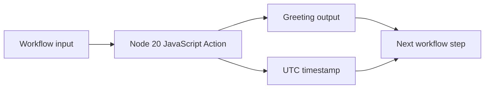

# Reusable JavaScript GitHub Action

   

A reusable GitHub Action demonstrating action inputs, outputs, Node.js packaging, and workflow integration.

## Inputs

| Name | Required | Default | Description |
|---|---:|---|---|
| who-to-greet | Yes | World | Name included in the greeting |

## Outputs

| Name | Description |
|---|---|
| time | UTC timestamp generated by the action |

## Workflow visual

## Example workflow

- name: Greet from a reusable action
  id: greeting
  uses: saadisher39891/content-javascript-actions-app@master
  with:
    who-to-greet: Platform team

- name: Show output
  run: echo Generated at ${{ steps.greeting.outputs.time }}

## Security and privacy

- Runs on the supported Node 20 GitHub Actions runtime.
- Reads only the declared greeting input.
- Does not print the triggering workflow event payload or other repository context to logs.
- Consumer workflows should use immutable release tags or commit SHAs instead of master.

## Engineering notes

- Inputs are declared in action.yml.
- Runtime behavior is implemented in JavaScript.
- Outputs are exposed for downstream workflow steps.
- The package is built for repeatable execution inside GitHub-hosted runners.

## Recommended next improvements

- Add unit tests for input handling and output formatting.
- Add CI for linting and tests.
- Publish immutable release tags.
- Pin third-party actions by commit SHA in consumer workflows.
- Add semantic versioning and a release guide.

This project supports a DevOps profile by showing practical CI/CD automation, workflow composition, privacy-aware logging, and reusable developer tooling.